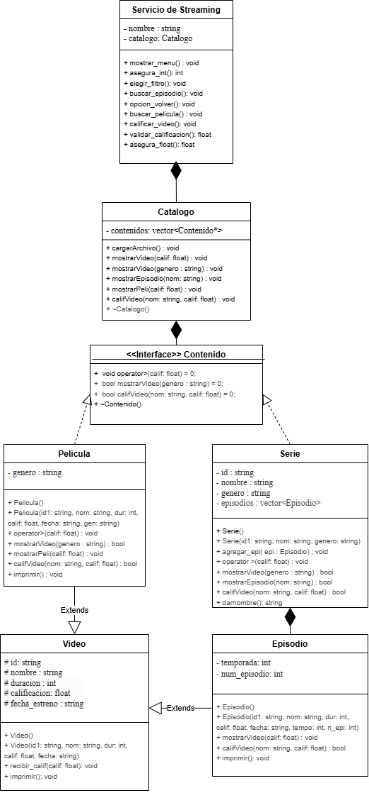

# Plataforma de Streaming en C++

Aplicación de consola que simula un servicio de streaming. Carga un catálogo de películas y series desde un archivo CSV y permite filtrar videos por calificación o género, consultar los episodios de una serie y calificar contenido.

Proyecto integrador de la materia Programación Orientada a Objetos (TC1030) del Tecnológico de Monterrey, Campus Estado de México.

## Funcionalidades

1. Cargar el catálogo desde `BasePeliculas.csv`
2. Mostrar videos (películas y episodios) con calificación mayor a un valor o de un género específico
3. Mostrar los episodios de una serie
4. Mostrar películas con calificación mayor a un valor
5. Calificar un video (la nueva calificación se promedia con la anterior)

El programa valida las entradas del usuario: maneja opciones fuera de rango, texto donde se espera un número, calificaciones fuera de 0 a 10, y géneros o videos que no existen.

## Diseño

- **Herencia:** `Pelicula` y `Episodio` heredan de `Video`, que concentra los atributos comunes.
- **Clase abstracta (interfaz):** `Contenido` define métodos virtuales puros que implementan `Pelicula` y `Serie`.
- **Polimorfismo:** `Catalogo` administra un solo `vector<Contenido*>` en lugar de vectores separados de películas y series.
- **Composición:** `Streaming` contiene un `Catalogo`, y cada `Serie` contiene sus `Episodio`.
- **Sobrecarga de métodos:** `mostrarVideo()` acepta una calificación o un género.
- **Sobrecarga de operadores:** el operador `>` compara calificaciones.
- **Excepciones:** `try`, `catch` y `throw` para manejar entradas inválidas sin que el programa se detenga.

El diseño evolucionó en cuatro versiones: [primera](PrimeraVersion.png), [segunda](SegundaVersion.png), [tercera](TerceraVersion.png) y [final](UltimaVersion.png).
